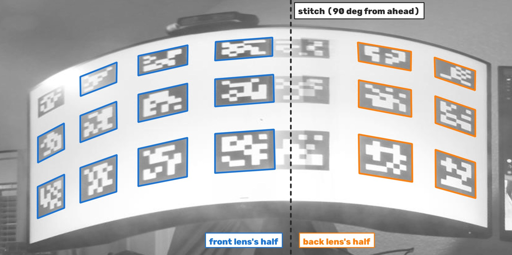

# napa-x4-pi

Reads AprilTags from an Insta360 X4's 360-degree webcam stream on a Raspberry Pi 5 and sends them, with a field pose
from every tag in view, to an FRC robot over NetworkTables. Detection is [NAPA](https://pypi.org/project/napa-vision/)
(`napa-vision`), unchanged; this repository adds what the X4's picture needs and the robot plumbing.

Version 0.2.0. Tested with one X4 on a Pi 5 (Debian 13, Python 3.13), NAPA 0.6.1 and pyntcore 2026. See the
[changelog](CHANGELOG.md).



*One X4 frame: tags on a monitor 0.6 m away, outlined by the lens that sees them. Each half of the picture comes
from its own lens, 28 mm apart; the column on the stitch, seen by both, is blended and doubled.*

## Is it for you?

- **It sees all around.** Tags behind and beside the robot count too, and a pose from tags all around is far
  steadier than one from tags in front: on a still camera it wanders by about 1 mm.
- **It's accurate where it can see.** Against tags at exactly known places, the fit was 0.22 px.
- **Range is short.** The 360 mode has 0.125 degrees per pixel, so a 6.5 in FRC tag is 16 px (the smallest it looks
  for) at 4.7 m. The 1080 mode reaches 6.3-8.5 m but is blind to each side.
- **It's slow to see.** The X4 delivers a frame about 100 ms after taking it (75 ms in the 1080 mode), and the Pi
  adds about 30. Every value carries the time its frame was taken, for latency compensation.
- **It blurs in dim light.** The X4 chooses its own exposure (about 23 ms in a dim room): a robot turning at 90
  degrees a second smears tags by about 16 px. Bright competition lighting helps; nothing on the Pi can change it.
- **Take heading from the gyro.** The X4 stabilizes its picture: after a quick turn its heading lags by a few
  degrees for several seconds. Use the camera's position from the field pose with the gyro's heading.
- **Geometry from one camera.** The two-lens model and the 1080 mode's calibration were measured on one X4.

Measured details: [docs/MEASUREMENTS.md](docs/MEASUREMENTS.md).
How it works: [docs/HOW-IT-WORKS.md](docs/HOW-IT-WORKS.md).

## What you need

- A **Raspberry Pi 5** with 64-bit Raspberry Pi OS or Debian 12 or later. (A Pi 4 is untested.)
- An **Insta360 X4** in webcam mode, plugged straight into the Pi with a USB-C cable (not through a hub or dock:
  some power the camera but pass no data).
- **Power for both.** A Pi 5 gives its USB ports only 600 mA in all unless its supply negotiates 5 A, and the X4
  charges and streams through that port. Use a 5 V / 5 A supply, or a regulator that can give 5 A with
  `usb_max_current_enable=1` in `/boot/firmware/config.txt`. On a robot, feed the Pi from a 5 V regulator on the PDH.
  Check the game manual's rules on cameras with their own batteries.
- **Robot code** on WPILib 2026 (pyntcore 2026 on the Pi speaks NetworkTables 4).

## Quick start

```sh
git clone https://github.com/zwatx/napa-x4-pi && cd napa-x4-pi
deploy/install.sh                  # .venv, /etc/x4tags.toml and the service (it asks for sudo for those)
sudo systemctl stop x4tags         # the service holds the camera; stop it to try things by hand
.venv/bin/x4tags --print           # camera -> one JSON line per frame
sudo nano /etc/x4tags.toml         # set [mount], [tags], [field] and [output] (below)
sudo systemctl restart x4tags && journalctl -u x4tags -f
```

Every 10 s the log shows the frame rate, decode and detect times, tags per frame, skipped and corrupt frames,
whether the frame clock is on and the CPU temperature. On the robot side, open AdvantageScope or OutlineViewer and
look under `/x4tags`.

## Camera setup

**Webcam mode.** Connect the X4 and choose Webcam on its USB menu. It then shows up as an ordinary UVC camera, and
x4tags finds it by its USB vendor ID. If it comes up as a USB drive instead, the log says so: choose Webcam again.
Check after a power cycle whether yours remembers the mode.

**Which picture.** The X4's webcam sends one of two sizes, set by `[camera] mode`:

| | 360 mode (`equirect`, default) | 1080 mode (`dual1080`) |
|---|---|---|
| Picture | 2880x1440, every direction | 1920x1080: front and back views, 76 degrees to each side, about 24 up and down |
| Blind to | nothing | 28 degrees on each side of the camera, and anything high or low |
| Range for a 16 px tag | 4.7 m | 6.3-8.5 m |
| Latency (default) | 100 ms | 75 ms |
| Frame times | steadied by the frame clock (jitter about 0.3 ms) | as they arrive (jitter about 13 ms) |

For tags all around a field, use the 360 mode. Turning the camera 45 degrees on the robot puts the 1080 mode's blind
gaps on the diagonals.

**Mounting.**
- Put it high enough that the robot doesn't fill the lower half, with neither lens blocked or exposed to hits. The
  X4 has a 1/4-20 socket.
- Each half of the picture comes from its own lens. They join on the **stitch**, 90 degrees to each side of the
  camera, where tags within a few degrees are trusted less. Point the lenses (not the stitch) at where tags matter
  most.
- Measure `[mount]` to the **middle of the camera body**, halfway between the two lenses.

**Networking.** Give the Pi a static address on the robot network (for example 10.TE.AM.11) and set
`[output] nt_server` to your team number. FRC fields allow team traffic on ports 5800-5810 (for the UDP output).

## Check your camera

Two things about the X4 aren't documented and decide how far to trust it. Check them once (stop the service first:
`sudo systemctl stop x4tags`).

**1. Does the picture follow the camera body?** One X4 followed quick turns within half a second, then the last
3-8 degrees came back slowly (time constant about 5 s); at rest it was still. No tag is needed:

```sh
.venv/bin/python -m x4tags.check_stabilization --tilt   # turn it and let go, then tilt it and let go, when told
```

It reports *body-fixed*, *follows ... but creeps*, *heading-locked* or *horizon-locked*. If the horizon is locked,
leave `[mount]` pitch and roll at 0.

**2. How late are frames?**
1. Run `.venv/bin/python -m x4tags.check_latency --host 0.0.0.0` on the Pi.
2. Open `http://<the Pi>:8765` in a browser on a laptop (or `http://localhost:8765` on the Pi, with a screen) and
   click it to go full screen. A tag starts sliding back and forth.
3. Point the X4 at the screen, the tag at about the camera's height, for 30 s.
4. It prints the latency, including the screen's own delay: roughly 15-25 ms at 120 Hz, 20-40 ms at 60 Hz. Subtract
   yours and put the rest in `[camera] latency_ms`.

The page times the tag by its own clock, synced to the Pi's, so the network between them doesn't matter. For the
1080 mode add `--mode dual1080`. Close pop-ups first: one covering the tag hides it.

## Settings

Everything lives in `/etc/x4tags.toml`; [config.example.toml](config.example.toml) lists every key with its default.
A setting that can't work stops the service with one line in the log saying which.

| Key | What to set |
|---|---|
| `[mount]` | where the camera sits on the robot (x, y, z to the middle of the camera body) and how it's turned (roll, pitch, yaw), in WPILib's robot frame. Positive pitch tips the view down, positive yaw turns it left; at zero the middle of the picture looks along the robot's +x |
| `[tags] size_m` | the black square's side: 0.1651 for FRC |
| `[field] layout` | the season's WPILib AprilTag layout JSON (below); turns on `field_pose` |
| `[output] nt_server` | your team number, a host, or `localhost:5810` for a simulator |
| `[camera] mode` | `"equirect"` (360 mode) or `"dual1080"` (1080 mode) |
| `[camera] latency_ms` | from `check_latency`; default 100 (360 mode) or 75 (1080 mode). At 4 m/s, 10 ms unaccounted for is 4 cm |

The rest rarely need changing: `[detector] min_tag_px` (16; NAPA's own default of 22 misses far tags),
`[detector] camera_gamma` (2.0: the X4's picture isn't linear in light), `[field] min_tags` (keep it at 2 or more:
one tag's pose has two nearly equal fits, metres apart) and `[field] corner_noise_px` (below).

**The field layout** is WPILib's JSON. Get the season's from WPILib (allwpilib's `apriltag` resources), or write
it from robot code with `AprilTagFieldLayout.loadField(...).serialize(path)`, and point `[field] layout` at it, for
example `/etc/x4tags-field.json`. Check which tag positions your event uses (some seasons have more than one).

## Robot code

NetworkTables 4, under `/x4tags` (rename it with `[output] nt_table`). Every value of a frame carries the time the
frame was taken (estimated: its arrival less `latency_ms`) as its NetworkTables timestamp.

| Topic | Type | |
|---|---|---|
| `field_pose` | double[] | with a field layout: 28 values (below), empty when there's no fit |
| `tags` | double[] | 7 values per tag: id, yaw_deg, pitch_deg, distance_m, x_m, y_m, z_m |
| `camera_connected` | boolean | true while frames arrive; `tags` and `field_pose` are emptied when it goes false |
| `status` | string | `ok`, or what's wrong (`no camera: ...`, `camera stalled: ...`, ...) |
| `frame`, `age_ms`, `decode_ms`, `detect_ms` | int, double | per frame: `age_ms` is from when the frame was taken to when it was sent (so it includes `latency_ms`); `detect_ms` includes the field pose |
| `version` | string | the x4tags version |

`field_pose` (`x4tags.publish.FIELD_POSE_FIELDS` names them):

| Index | Value |
|---|---|
| 0-2 | robot x, y, z (m) |
| 3-5 | robot roll, pitch, yaw (deg) |
| 6-8 | camera x, y, z (m): the middle of the camera body |
| 9 | how closely the corners fit (px) |
| 10 | tags used |
| 11 | xy_std_m: the camera position's standard deviation in its least certain direction |
| 12 | yaw_std_deg |
| 13-21 | the robot (x, y, yaw) covariance, 3x3 row by row, field axes, m and rad |
| 22-25 | the camera (x, y) covariance, 2x2 row by row, field axes, m |
| 26-27 | the camera position's standard deviations along the robot's forward and left axes (m) |

Because of the heading lag, use the camera's x and y (values 6-7) with the gyro's heading, not the robot pose
(values 0-5, 13-21), unless `check_stabilization` finds the picture body-fixed. A complete example for WPILib's pose
estimators, assuming the robot drives level:

```java
import edu.wpi.first.math.VecBuilder;
import edu.wpi.first.math.estimator.SwerveDrivePoseEstimator;
import edu.wpi.first.math.geometry.Pose2d;
import edu.wpi.first.math.geometry.Rotation2d;
import edu.wpi.first.math.geometry.Translation2d;
import edu.wpi.first.networktables.DoubleArraySubscriber;
import edu.wpi.first.networktables.NetworkTableInstance;
import edu.wpi.first.networktables.PubSubOption;
import edu.wpi.first.networktables.TimestampedDoubleArray;
import edu.wpi.first.wpilibj.Timer;

public class X4Vision {
    // [mount] x_m, y_m: where the middle of the camera body is on the robot
    private static final Translation2d MOUNT = new Translation2d(0.10, 0.0);
    private static final double FLOOR_M = 0.03;   // for errors the covariance leaves out; tune it on the field
    private static final double MAX_AGE_S = 0.5;

    private final DoubleArraySubscriber poseSub = NetworkTableInstance.getDefault().getTable("x4tags")
        .getDoubleArrayTopic("field_pose").subscribe(new double[0], PubSubOption.pollStorage(10));

    /** Call every robot loop: adds each new camera pose once. */
    public void update(SwerveDrivePoseEstimator estimator) {
        for (TimestampedDoubleArray pose : poseSub.readQueue()) {
            double[] v = pose.value;
            double taken = pose.serverTime / 1e6;              // when the frame was taken (FPGA time)
            if (v.length < 28 || Timer.getFPGATimestamp() - taken > MAX_AGE_S
                    || !Double.isFinite(v[26]) || !Double.isFinite(v[27])) {
                continue;
            }
            Rotation2d heading = estimator.sampleAt(taken)       // the heading when the frame was taken
                .map(Pose2d::getRotation).orElse(estimator.getEstimatedPosition().getRotation());
            Translation2d robot = new Translation2d(v[6], v[7]).minus(MOUNT.rotateBy(heading));
            estimator.addVisionMeasurement(new Pose2d(robot, heading), taken,
                VecBuilder.fill(Math.max(v[26], FLOOR_M), Math.max(v[27], FLOOR_M), Double.POSITIVE_INFINITY));
        }
    }
}
```

`readQueue` hands over each new pose once; reading the latest value every loop would add the same pose several
times. Infinite heading uncertainty leaves the heading to the gyro. With CTRE's generated swerve drivetrain, its
`addVisionMeasurement` and `samplePoseAt` take FPGA time like WPILib's (it converts them); check yours.

`tags` reads the same way, 7 values per tag. Yaw (left of the robot's forward) and pitch (above horizontal) are the
direction of the tag's centre from the lens that sees it, in robot axes; for a tag 1 m away to the side that can
differ from the direction from the body's middle by up to 0.8 degrees. Distance and position are NaN without
`[tags] size_m` or when the tag's pose fits poorly.

**UDP and stdout** (`[output] udp`, `print`) carry one JSON object per frame instead: `seq`, `age_ms`, `decode_ms`,
`detect_ms`, `size`, `tags` (each with `id`, `yaw_deg`, `pitch_deg`, `corners_px`, `refined`, `seam`, `near`,
`hamming`, `margin`, and with a pose `distance_m`, `position_m`, `rotation`, `pose_error_px`) and `field_pose`
(`robot_xyz_m`, `robot_rpy_deg`, `camera_xyz_m`, `rms_px`, `tags` (IDs), `xy_std_m`, `yaw_std_deg` and, when it has
them, `robot_covariance`, `camera_xy_covariance`, `gyro_std_devs_m`). There's no shared clock: take the receive time
less `age_ms` as when the frame was taken.

### Pose uncertainty

The covariances come from the fit's geometry and an assumed random error in each corner, `[field] corner_noise_px`
(0.5 px). Two small, distant tags in nearly the same direction can fit well and still be weak, and the covariance
says so. In a rendered room, the camera position's `xy_std_m` was about 0.7 mm from every tag in view, 1.6 mm from
the three largest and 9 mm from the two largest. Correlations are capped (with NAPA's `cap_correlations`) so that
two-tag poses aren't overconfident.

The covariances cover random corner error only, not tags that are off from the layout, timing or the heading lag,
and those don't shrink with more tags. Put a floor under the standard deviations on the robot, a few centimetres to
start, and tune it on the field. WPILib takes one standard deviation per axis, so it can't use the x-y correlation:
for a weak two-tag pose that leaves the per-axis figures up to 1.4 times too small along the ellipse's long axis.
Pass `xy_std_m` (value 11) for both axes to err on the cautious side.

## Troubleshooting

| You see | Do |
|---|---|
| `no Insta360 X4 on USB` | check the cable and power; plug it straight into the Pi |
| `the X4 is on USB but isn't a webcam` | choose Webcam on the camera's USB menu |
| `camera sends 1920x1080, not ...` | set `[camera] mode` to match the camera, or switch the camera's output |
| `settings /etc/x4tags.toml: ...` | fix the key it names; the service retries on its own and starts once it's right |
| `could not open /dev/video0` | something else has the camera: `sudo systemctl stop x4tags` before a check or a manual run |
| no `field_pose` | is `[field] layout` set, and are 2 or more of its tags in view? Tags must fit within `[field] max_rms_px` and the pose within `max_xy_std_m` |
| `frame clock off (arrival times)` | normal for 2-3 s after starting, and always in the 1080 mode |
| `the clock jumped`, `NetworkTables: disconnected` | NetworkTables restarts or reconnects on its own; for a steady clock, turn off NTP on the coprocessor |
| `status` stuck on `camera stalled` | unplug and replug the X4 |

To look at a problem away from the robot, record the camera and replay it:

```sh
v4l2-ctl -d /dev/video0 --set-fmt-video=width=2880,height=1440,pixelformat=MJPG \
    --stream-mmap --stream-count=300 --stream-to=rec.mjpg            # 10 s
.venv/bin/x4tags --config /etc/x4tags.toml --replay rec.mjpg --print
```

## Updating and uninstalling

```sh
git pull && deploy/install.sh      # reinstalls and restarts the service; keeps /etc/x4tags.toml
deploy/install.sh --uninstall      # stops and removes the service (keeps the settings and .venv)
```

After an update, compare `/etc/x4tags.toml` with `config.example.toml`: a key that's gone stops the service with a
message naming it.

## Limits

- Range: 4.7 m for a 16 px tag in the 360 mode; distant tags need a narrower camera.
- Latency about 100 ms before the Pi starts; exposure up to about 23 ms in dim light.
- The heading lags after turns: take heading from the gyro.
- A tag right on the stitch is seen partly by each lens: its own pose can be off by about 1 cm (the field pose takes
  each corner from its own lens and trusts corners there less).
- A face-on tag's own pose has two near-equal rotations; the reported one can be tilted a few degrees the wrong way.
- The 1080 mode's frame times jitter by about 13 ms, and its calibration and the two-lens model come from one X4.
- Values sent before NetworkTables has synced its clock with the robot may carry the Pi's own time base.

## Development

```sh
python -m venv .venv && .venv/bin/pip install -e ".[nt,test,lint]"
.venv/bin/pytest && .venv/bin/ruff check src tests
```

The tests render 360-degree frames and rooms of tags with exact truth, and fit one real X4 frame
(`tests/fixtures`). The pieces work on their own too:

```python
from x4tags import X4TagDetector, X4Webcam
from x4tags.field import FieldLayout
from x4tags.localize import FieldLocalizer

# X4TagDetector defaults to min_tag_px=16 and camera_gamma=2.0; other NapaDetector options pass through
with X4Webcam() as cam, X4TagDetector() as det:
    loc = FieldLocalizer(FieldLayout.load("field.json"), tag_size_m=0.1651)
    t, gray = cam.read()                         # (when it was taken, as well as the clock knows; grey frame)
    tags = det.detect(gray)
    for tag in tags:
        print(tag.tag_id, tag.bearing_deg(), det.pose(tag, 0.1651))  # pose: (R, t, error px) or None
    pose = loc.solve(tags, gray.shape[0], det.px_per_rad(gray.shape[1], gray.shape[0]))  # FieldPose or None
```

| Path | |
|---|---|
| `src/x4tags/capture.py` | `X4Webcam`: finds the X4, captures the newest frame in grey, and the frame clock |
| `src/x4tags/equirect.py`, `dual.py` | pixels to directions and back, for the 360 mode and the calibrated 1080 mode |
| `src/x4tags/detector.py` | `X4TagDetector`: NAPA plus the seam, close-tag views, bent-tag refinement, single-tag poses and the two lens centres |
| `src/x4tags/field.py`, `localize.py` | WPILib field layouts, and the field pose from all tags |
| `src/x4tags/mount.py`, `results.py` | camera to robot frame, and each frame's results |
| `src/x4tags/publish.py`, `app.py`, `config.py` | outputs, the service loop and its settings |
| `src/x4tags/check_latency.py`, `check_stabilization.py` | the camera checks |
| `deploy/` | the installer and systemd unit |

## License

GPL-3.0-only, like NAPA.
