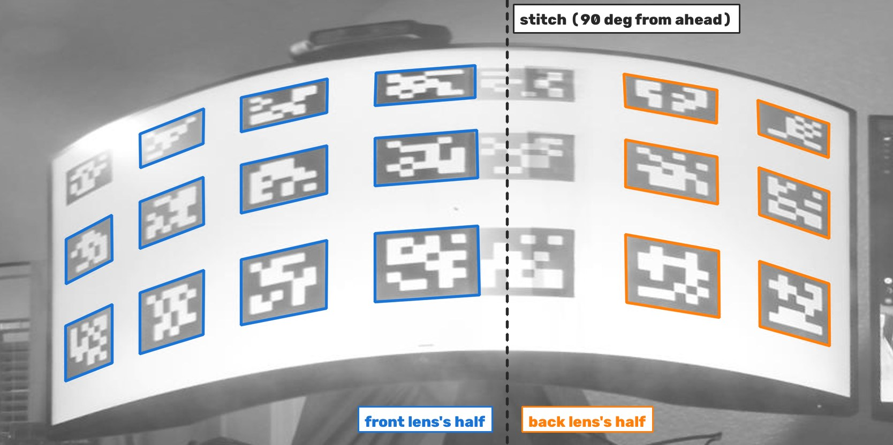

# How it works

NAPA finds the tags. Everything here is about the X4's picture and the robot: where the picture's geometry differs
from a normal camera's, and how frames become timed, robot-frame results. Measurements behind the numbers are in
[MEASUREMENTS.md](MEASUREMENTS.md).

## The picture

In the **360 mode** the X4 sends a 2880x1440 equirectangular picture: each column is a direction around the camera
(longitude), each row a height (latitude), 458 px per radian. Straight lines come out curved, more so for big tags
and away from the horizon. In the **1080 mode** it sends two views stacked (back above front), each 76 degrees to
either side and about 24 degrees up and down; `dual.py` holds a calibration of that layout from one X4 (good to
about 0.3 px on measurements the fit didn't see). Insta360 documents neither.

Two lines matter:

- The **seam** is the 360 picture's left and right edge. Both look straight back, so a tag there is cut in two.
- The **stitch** is where the camera joins its two lenses' pictures: the circle 90 degrees from straight ahead,
  through the sides. It isn't an edge of the picture; it's where the picture changes from one lens to the other.

## Finding tags

`X4TagDetector` runs NAPA on the frame, then:

- **The seam.** A strip made of the frame's right and left edges side by side is searched too, so a tag cut by the
  seam is whole in it.
- **Close tags.** Closer than about half a metre a tag's sides bow by 5-40 px and NAPA can't fit it in the frame at
  all. Twelve low-resolution flat (pinhole) views, spread evenly around the sphere, cover these: each frame searches
  two of them in rotation, plus any view that found a tag the frame before.
- **Bent tags.** A tag whose sides the frame bends by more than 0.2 px is looked at again through a small flat view
  centred on it, where its sides are straight, and its corners are mapped back.

The seam and close-tag searches run on a second core, with their own NAPA detector, while NAPA searches the frame.
Frames are decoded straight to grey (libjpeg skips the colour) on a third thread, which keeps only the newest.

NAPA undoes a gamma of 2.0 before fitting tag edges (`camera_gamma`): the X4's picture isn't linear in light, and
blur makes a tag's border look narrower than it is unless the gamma is undone.

## Two lenses

The X4's lenses sit back to back, and each half of the picture is seen from its own lens's centre, 28 mm apart: 14 mm
ahead of and behind the middle of the camera body. Treating the picture as taken from one point puts the halves
11-13 px apart for things 1 m away, about 4 px at 3 m. So every corner is taken from the lens of the half it's in
(`detector.lens_centre`), in single tags' poses and in the field pose, and positions are reported from the middle of
the body.

Right at the stitch the camera blends the two lenses' views (the doubled column in the picture above): from about 5
degrees before it to 3 degrees after, a tag can be shifted and bent by a few pixels. The field pose counts corners
there as up to 8 times less certain, fading to normal 10 degrees from it.

## Frame times

The X4 takes frames on a steady 29.97 fps clock but delivers them over USB late by an uneven amount, in a repeating
pattern of three (in the 360 mode about 16, 9 and 0 ms late, plus noise). Stamping each frame by its arrival would
make the times jitter by about 6 ms.

`FrameClock` finds the camera's clock instead: the period, and the edge that gives every frame a slot of its own (a
frame can't arrive early, so the earliest arrivals mark the clock). It refits that line by least squares over the
last 20 s and stamps each frame with its slot time plus the window's mean delay. That keeps the arrivals' average, so
a latency measured from arrivals still applies, without the jitter. It takes about 3 s to lock on, lets go when
frames stop fitting a steady clock, and doesn't lock on at all when frames arrive up to 80% of a period late, as in
the 1080 mode, where a frame's slot would be a guess. Arrival times come from V4L2's own buffer stamp (when the USB
transfer began), so a busy thread doesn't delay them.

Each value sent to the robot is stamped with that time less `[camera] latency_ms`: when the frame was taken, as well
as it can be known.

## The field pose

`FieldLocalizer` fits one camera pose to the directions of every visible tag's corners at once: angles on the
sphere, so it works across the whole picture, where a pinhole model can't. It starts from the largest tags' own
poses, refines with a robust (Huber) Levenberg-Marquardt fit, and accepts a pose only when every tag fits within
`[field] max_rms_px`. If one doesn't (a misread ID, a moved tag), it tries again without the worst-fitting tag, then,
with up to 8 tags, without each in turn.

The covariance comes from the fit's Jacobian and the assumed corner noise, rotated into the field frame. From two
tags a linearized covariance is too sure of some combinations of position and heading, so its correlations are
capped with NAPA's `cap_correlations`. The robot pose and its covariance go through the mount with NAPA's pose
types; the camera's x-y standard deviations along the robot's axes (`field_pose` values 26-27) are what WPILib's
estimators take.

The heading the fit finds is the picture's, which lags the body after quick turns (the X4 stabilizes its picture),
so the robot code takes the camera's position with the gyro's heading. The picture turns about its lenses, which
barely moves them: a few degrees of lag moved the camera position by 1-2 mm in a simulation.

## Frames and corners

The camera frame is OpenCV's: x right, y down, z forward (the middle of the picture). Corners come in NAPA's order:
the printed bottom-right first, then bottom-left, top-left and top-right. In WPILib's tag frame (x out of the face,
y to a viewer's right, z up) those are (0, s/2, -s/2), (0, -s/2, -s/2), (0, -s/2, s/2) and (0, s/2, s/2). A tag
across the seam keeps its quad whole, so a corner's column can be below 0 or past the width.

## Latency

`check_latency` slides a tag back and forth on a screen at a known speed, timed by the browser's clock synced to the
Pi's. Where the tag is in each frame says when the frame was taken, and the latency is the delay that lines that up
with the frame times, fitted over every frame. Timing a tag that flips instead reads about half a frame plus half
the exposure too long: the flip lands anywhere in the camera's frame interval and shows only from the next frame.
